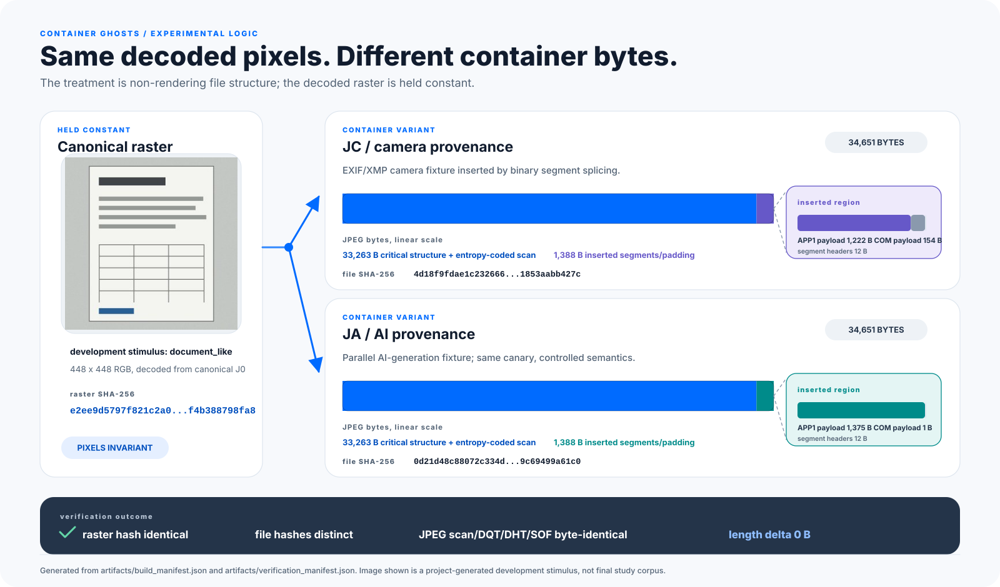
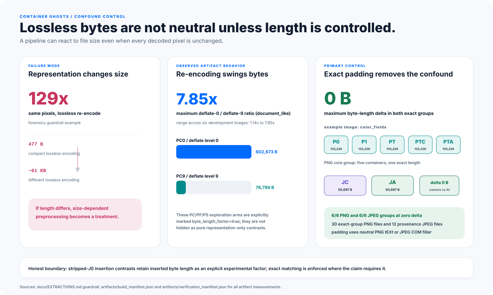
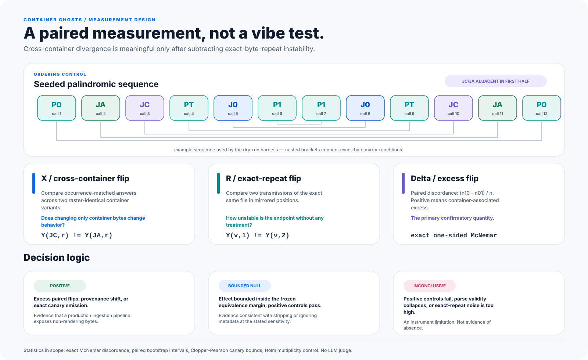
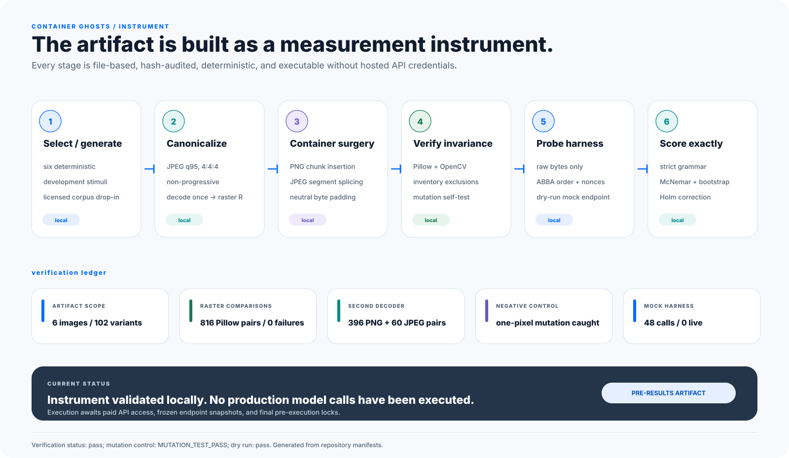

# Container Ghosts

**Do vision-language models read pixels or files?**

Container Ghosts is a black-box measurement artifact for auditing production vision-language ingestion pipelines. It constructs paired image files whose decoded RGB rasters are byte-identical while their container bytes differ in controlled, non-rendering ways: PNG ancillary chunks and lossless compression representation, JPEG EXIF/XMP/COM segments inserted by binary splice, and provenance polarity fixtures with embedded canaries.

If an ingestion pipeline is pixel-only with respect to those bytes, container-different inputs should not diverge more often than exact byte repetitions. Excess paired flips, semantic provenance shifts, or exact canary emission would be evidence of a hidden metadata/container channel somewhere in the deployed pipeline.



> **Status: pre-results artifact.** The instrument is built and locally validated. No production model calls have been executed, no endpoint results exist, and no stripping or metadata-ingestion claim is made here. Execution awaits paid API access, frozen model snapshots, final corpus licensing, and pre-execution locks.

## Evidence at a glance

These numbers describe the current deterministic development build, not model behavior:

| Measurement | Current artifact |
|---|---:|
| Development stimuli | 6 deterministic procedural RGB images, 448 × 448 |
| Variants | 17 per image, 102 total |
| Core probe variants | `J0`, `P0`, `P1`, `PT`, `JC`, `JA` |
| File differentiation | 17/17 distinct SHA-256 file hashes per image |
| Pillow pairwise raster comparisons | 816 compared, 0 mismatches |
| OpenCV pairwise checks | 396 PNG pairs + 60 JPEG pairs, 0 mismatches |
| Exact length-control groups | 0 B maximum delta in both groups, 6/6 images |
| Verifier negative control | one-pixel mutation rejected by Pillow and OpenCV |
| Probe harness dry run | 48 mock calls, 0 live calls, validation pass |
| Production endpoint results | none |

## The scientific design

### 1. Hold the raster constant, manipulate the container

The canonical scientific raster is not the source image directly. Each source is encoded once as canonical JPEG `J0` using pinned parameters, then decoded with pinned Pillow. That decoded RGB byte string is the canonical raster `R`. Every scientific variant must decode back to exactly `R`.

| Variant family | Construction | Interpretation |
|---|---|---|
| `J0` | JPEG quality 95, 4:4:4, non-progressive, optimize off, metadata stripped | canonical JPEG baseline |
| `P0` | pinned PNG deflate-6, filter None, single IDAT | canonical PNG baseline |
| `P1` | same raster as `P0`, different deflate level, Paeth filtering, split IDAT chunks | lossless representation-only contrast |
| `PT` | neutral PNG `tEXt`, `zTXt`, and XMP `iTXt` chunks plus canary | ancillary-chunk ingestion probe |
| `PTC` / `PTA` | camera-style versus AI-generator-style PNG ancillary provenance | extended provenance exploration |
| `JC` / `JA` | camera versus AI EXIF/XMP/UserComment inserted into `J0` by byte-level JPEG segment splicing | primary provenance polarity pair |
| `JXMP` / `JCOM` | neutral JPEG XMP or COM insertion | extended JPEG insertion controls |
| `PC0` / `PC9`, `PF1`-`PF4`, `PS2K` | deflate-level, PNG filter, and IDAT-splitting exploration arms | representation exploration, with byte length treated as an explicit factor |

The probe harness currently schedules the six core variants: `J0`, `P0`, `P1`, `PT`, `JC`, `JA`. The additional arms are generated and verified offline so representation and metadata construction can be inspected without silently widening the planned live-call matrix.

JPEG metadata is never re-encoded with `Image.save()` or `cv2.imwrite()`. It is inserted as length-prefixed segments after SOI. PNG metadata is inserted as CRC-valid chunks without touching IDAT bytes. This distinction is essential: high-level re-saving can rewrite quantization, Huffman coding, filter choices, or compressed scan data.

### 2. Byte length is a confound, so it is controlled exactly

Lossless representation changes can swing file size even when every pixel is identical. In the current development build, deflate-0 versus deflate-9 size ratios range from 1.14× to 7.85× across the six images. The maximum case is 602,673 B versus 76,799 B for `document_like`. A pipeline could react to that size difference without reading any metadata semantics.

The artifact therefore applies neutral byte padding and verifies exact zero length deltas where the scientific claim requires it:

| Exact-control group | Members | Current maximum delta |
|---|---|---:|
| `png_core_exact` | `P0`, `P1`, `PT`, `PTC`, `PTA` | 0 B across 6/6 images |
| `jpeg_provenance_exact` | `JC`, `JA` | 0 B across 6/6 images |

Not every comparison is length-controlled. That is deliberate and disclosed: stripped-`J0` versus metadata-bearing JPEG contrasts retain inserted byte length as an experimental factor, and the `PC`/`PF`/`PS` representation explorations are marked `byte_length_factor=true` in the machine-readable manifest.



### 3. Exclude rendering-relevant metadata

The verifier enforces an exclusion checklist rather than trusting format labels:

- no EXIF Orientation and no embedded EXIF thumbnails;
- no ICC/APP2, PNG `iCCP`, Adobe APP14, or color-rendering differences;
- no progressive JPEG structure or restart-marker differences;
- JPEG scan bytes, DQT, DHT, SOF, and restart parameters byte-identical across JPEG variants;
- no PNG rendering/color/animation chunks introduced as differences;
- no PNG `eXIf` in clean invariant arms;
- PNG IHDR, color type, bit depth, interlace method, IDAT contiguity, and decoded scanline bytes invariant.

PNG is exact cross-decoder lossless compression, so PNG disagreement under Pillow or OpenCV is a failure. JPEG decoding is implementation-dependent at the IDCT/upsampling layer, so the audit treats fixed-decoder raster identity plus byte-identical entropy-coded scan and decoding-critical segments as the container guarantee. Cross-decoder JPEG equality is still recorded rather than assumed.

### 4. Measure divergence against exact-repeat noise



Each core `(image, endpoint)` sequence is a seeded palindrome:

```text
pi(1), pi(2), ..., pi(6), pi(6), ..., pi(2), pi(1)
```

The permutation contains the six core variants, with `JC` and `JA` adjacent in the first half and their internal order randomized. Mirror positions repeat the exact same file bytes, embedding the exact-repeat noise baseline in every sequence. Unique per-call nonces are included in the prompt to reduce implicit cache reuse. Each transmitted payload is constructed directly from raw file bytes, never a PIL object, and the SHA-256 of those bytes is logged.

The forced-choice probe asks three independent questions and requires exactly three comma-separated letters, for example `A,B,A`:

1. count-or-color judgment;
2. caption forced choice;
3. camera photograph versus AI-generated judgment.

Option letters are randomized once per image, then fixed across variants and repetitions. Scoring strips whitespace, enforces the exact grammar, maps letters back to semantic labels, and uses no fuzzy matching or LLM judge.

Positive controls are part of the experimental design, not an optional analysis decoration. Before interpreting a null, the pilot/full design requires explicit textual provenance controls and pixel perturbation controls to pass their sensitivity gates. Those controls have not been executed because no live endpoint has been run.

### 5. Primary estimand, exact statistics, and equivalence-bound preregistration

For each endpoint, the primary contrast is `prov = (JC, JA)` and the primary probe is the camera-versus-AI judgment.

For image `i`:

- `X_i` indicates an occurrence-matched cross-container flip;
- `R_i` indicates a flip between exact byte repetitions;
- `D_i = X_i - R_i` is the paired discordance;
- the excess paired flip rate is `Delta = (n10 - n01) / n`.

The primary test is an exact one-sided McNemar test on `(n10, n01)`, endpoint by endpoint. The analysis scaffolding also implements discordance tables, exact-repeat noise comparisons, paired bootstrap percentile intervals, Clopper-Pearson intervals, Newcombe/Wilson score intervals, semantic provenance shift helpers, canary scans, and Holm adjustment. Unit tests include worked numeric examples.

The deep-research amendments require a numeric equivalence bound to be frozen before the first live call. That is what makes a null interpretable: not “no significant effect,” but an upper bound inside a predeclared margin with positive controls passing. The current repository contains the bounded-null decision logic and statistical machinery, but not a timestamped final preregistration lock, final numeric margin, or frozen endpoint snapshot. Those remain explicit pre-execution gates.

## Why the result is informative either way

| Outcome | Required evidence | Interpretation |
|---|---|---|
| Positive | excess paired flips, semantic provenance shift, or exact canary emission | evidence that the production ingestion pipeline exposes non-rendering container bytes or byte-dependent preprocessing behavior |
| Bounded null | effect bounded inside the frozen equivalence margin and positive controls pass | rigorous evidence consistent with stripping or ignoring metadata on the audited surface at the stated sensitivity |
| Inconclusive | controls fail, parse validity collapses, endpoint noise too high, or cost/operability gates fail | instrument limitation, not evidence of absence |

A positive result would not prove that model weights directly tokenize metadata. The claim is deliberately about the black-box production pipeline, which includes parsers, transcoders, cache layers, upload handling, resizing, and metadata extraction. Conversely, a bounded null would not rule out every small or conditional effect. It would bound the effect on the exact audited surface, dates, model snapshots, and input format. Because positive controls must first demonstrate semantic and visual sensitivity, that bounded-null branch would be rigorous stripping evidence rather than an uninformative absence of significance.

The deep-research scan found no prior powered, production-endpoint audit combining raster-hash verification, embedded camera/AI provenance and canaries, exact-repeat baselines, and paired statistics. A sensitivity-bounded null would therefore be the first such stripping evidence identified by that scan. The novelty assessment is documented with confidence limits in `docs/EXTRACTIONS.md`; it is not treated as absolute.

## Verification highlights



The artifact is designed so verification can fail loudly:

- **Mutation-tested verifier:** the self-test flips one channel of one pixel in a regenerated PNG. Both Pillow and OpenCV comparisons reject it with exactly `1 pixels differ`; acceptance would fail the run.
- **Deterministic regeneration:** `ghosts.regeneration_check` snapshots base/reference/variant bytes and the build manifest, rebuilds them, and requires identical SHA-256 values.
- **Hash-audited containers:** every variant records file SHA-256, byte length, raster hashes under both decoders, chunk/segment inventories, inventory deltas, and byte-length-control status; the manifest records the per-image canary.
- **Mock probe harness:** the dry run exercises provider-shaped OpenAI/Anthropic/Google payloads, palindromic ordering, exact-repeat mode, nonces, raw-byte transport, timestamps, payload hashes, response grammar, and schedule validation. It performs 48 mock calls and zero live calls.
- **Pinned environment:** `requirements.txt` is fully pinned and `environment.json` records Python, platform, dependency versions, dependency tree hashes, and the requirements hash.

## One-command reproduction

```sh
git clone https://github.com/nikolas-sapa/container-ghosts.git
cd container-ghosts
./run.sh
```

`run.sh` creates `.venv` if needed, installs pinned dependencies, then:

1. writes `environment.json`;
2. regenerates all development stimuli and variants;
3. verifies deterministic regeneration;
4. verifies raster/container invariance and runs the one-pixel mutation control;
5. exercises the mock probe harness;
6. regenerates the figures in `docs/figures/` from the resulting manifests;
7. runs the unit test suite.

It makes no hosted model API calls and requires no credentials. Generated bytes and reports are written under `artifacts/`, which is intentionally gitignored. Inspect especially:

- `artifacts/build_manifest.json` for source/variant hashes, byte lengths, generation parameters, padding policy, canaries, and probe labels;
- `artifacts/verification_manifest.json` for raster hashes, decoder comparisons, inventory diffs, critical JPEG byte identity, pairwise counts, and failures;
- `artifacts/dryrun/probe_dryrun.jsonl` for mock probe-call records;
- `artifacts/dryrun/dryrun_report.json` for dry-run validation status.

A licensed corpus drop-in interface exists:

```sh
.venv/bin/python -m ghosts.build_variants --out artifacts --corpus /path/to/licensed-images
```

This is a development interface only. It does not replace the licensing, label-quality, face/privacy, near-duplicate, and redistribution audit required before any scientific run.

## Repository layout

```text
container-ghosts/
├── run.sh                         # one-command local reproduction
├── requirements.txt               # pinned runtime/test dependencies
├── requirements-c2pa.txt          # optional experimental C2PA dependency
├── configs/endpoints.json         # provider payload stubs and ingestion contrast note
├── ghosts/
│   ├── build_variants.py          # canonicalization, variant construction, exact padding
│   ├── pngcodec.py                # CRC-valid PNG encode/chunk surgery/inventory
│   ├── jpegcodec.py               # JPEG segment splice/padding/inventory
│   ├── metadata.py                # EXIF/XMP/provenance/canary fixtures
│   ├── verify_invariance.py       # raster, inventory, exclusion, mutation verification
│   ├── regeneration_check.py      # deterministic regeneration check
│   ├── probe_harness.py           # raw-byte payload and dry-run harness skeleton
│   ├── score.py                   # exact parser, semantic mapping, flip/canary helpers
│   ├── stats.py                   # exact McNemar, intervals, bootstrap, Holm
│   └── c2pa_arm.py                # narrow experimental C2PA interface, inactive by default
├── tests/                         # codec, verifier, harness, and statistics tests
├── scripts/generate_figures.py    # programmatic figure generation from manifests
└── docs/
    ├── SPEC.md                    # original scientific specification
    ├── EXTRACTIONS.md             # deep-research constraints and amendments
    └── figures/                   # generated presentation figures
```

## Boundaries and known limitations

- **No results yet.** There are no production endpoint observations, effect estimates, p-values, or endpoint rankings.
- **Development corpus only.** The six procedural images are not the final licensed 50-image corpus and do not represent natural-image diversity.
- **Preregistration is not finally locked.** The specification and deep-research amendments are present, but exact model snapshots, final numeric equivalence bounds, final corpus manifest, and execution timestamps remain unfrozen.
- **Positive controls are designed but unexecuted.** A future null is uninterpretable unless those controls pass.
- **Camera provenance realism is limited.** The EXIF fixture uses a real IFD hierarchy and plausible fields, but does not copy proprietary MakerNotes or a camera-specific full header signature.
- **C2PA is inactive.** A narrow local signing interface exists. Investigation found scan/DQT/DHT/SOF preservation in a probe, but repeated signing was not byte-deterministic because the SDK generated fresh manifest UUIDs. C2PA remains stubbed out of the invariant core.
- **Live adapters are absent.** `configs/endpoints.json` contains payload-shape stubs with unset model snapshots. Inline base64 is primary; Files API ingestion is only a documented future contrast.
- **The implementation exceeded the draft line-count skeleton.** The scientific constraints were prioritized over the original sub-700-line implementation target in `docs/SPEC.md`; `ghosts/` is now larger and more explicit.
- **Specification amendments matter.** `docs/SPEC.md` is the original design. `docs/EXTRACTIONS.md` contains later mandatory constraints, including 448 × 448 primary dimensions, raw-byte transport, equivalence bounds, and byte-length matching. Read them together.

## Citation

Citation metadata is provided in `CITATION.cff`. Until an archival DOI exists, cite the repository as:

```bibtex
@software{sapalidis_container_ghosts_2026,
  author  = {Sapalidis, Nikolas},
  title   = {Container Ghosts: A Raster-Verified Audit Instrument for Vision-Language Ingestion Pipelines},
  year    = {2026},
  url     = {https://github.com/nikolas-sapa/container-ghosts},
  note    = {Pre-results artifact; instrument validation only}
}
```

## License

MIT. See `LICENSE`. The license applies to the project-generated code, development stimuli, figures, and documentation in this repository. Future third-party study images may be governed by separate licenses and redistribution constraints.
